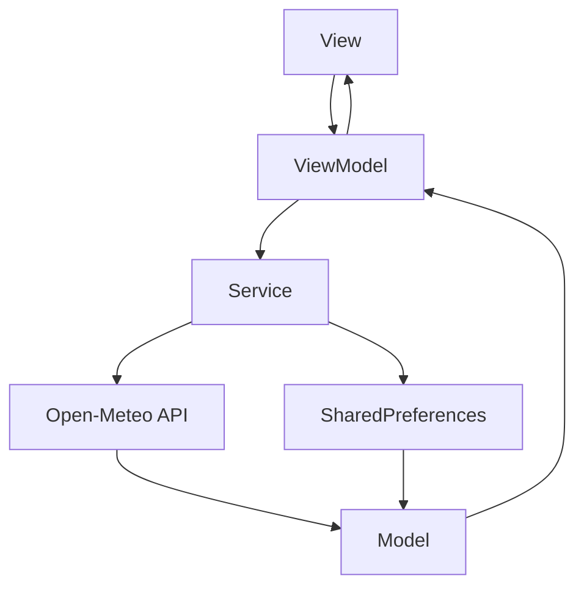
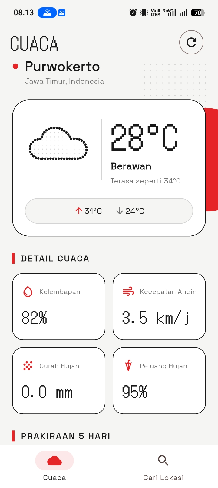
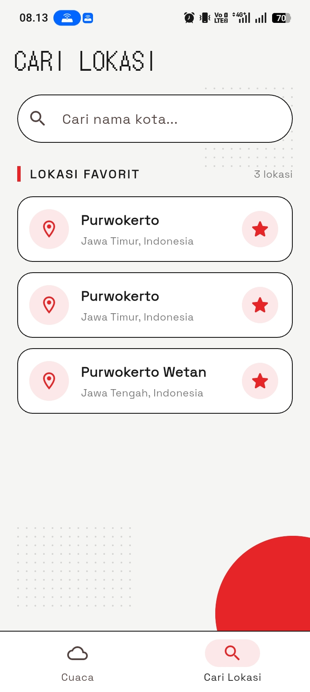
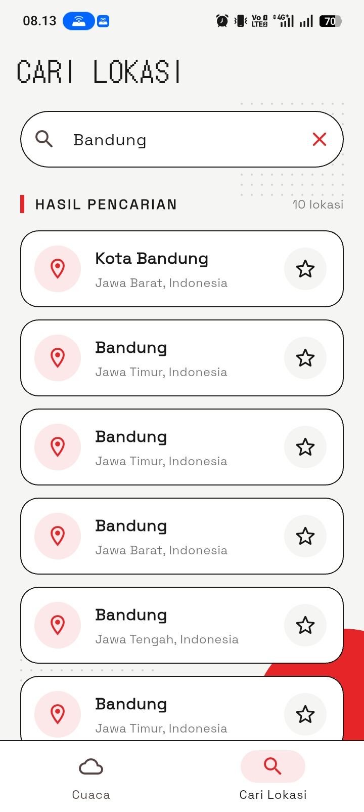

# Weatherly

Weatherly adalah aplikasi informasi cuaca berbasis Flutter yang menggunakan Open-Meteo API dengan desain minimalis terinspirasi Nothing OS, warna merah, hitam dan putih, typography dot-matrix, serta custom weather icons.

## Identitas Mahasiswa

| Keterangan | Informasi |
|---|---|
| Nama | Ninik Rahayu |
| NIM | H1D024024 |
| Shift Awal | H |
| Shift Akhir | F |
| Mata Kuliah | Praktikum Pemrograman Mobile |
| Project | Weatherly |

## Fitur

- Informasi cuaca terkini, suhu terasa, kelembapan, angin, curah dan peluang hujan.
- Prakiraan lima hari dengan suhu maksimum dan minimum.
- Pencarian lokasi dan pemilihan kota.
- Tambah dan hapus favorit yang tersimpan pada SharedPreferences.
- Refresh, loading, empty, error state, responsive UI dan custom dot-matrix icons.

## Teknologi

Flutter, Dart, Provider, HTTP, SharedPreferences, Intl, Google Fonts, CustomPainter dan Flutter Test.

## Arsitektur MVVM

Model merepresentasikan data dan melakukan parsing JSON. View menampilkan data serta menerima interaksi pengguna. ViewModel mengatur state dan menghubungkan View dengan Service. Service mengakses API dan penyimpanan lokal.



## Struktur Folder

```text
lib/
├── models/
│   ├── location_model.dart
│   ├── forecast_model.dart
│   └── weather_model.dart
├── services/
│   ├── geocoding_service.dart
│   ├── weather_service.dart
│   └── storage_service.dart
├── viewmodels/
│   ├── weather_viewmodel.dart
│   └── location_viewmodel.dart
├── views/
│   ├── main_screen.dart
│   ├── weather_screen.dart
│   └── search_screen.dart
├── widgets/
│   ├── dot_pattern.dart
│   ├── dot_weather_icon.dart
│   ├── nothing_card.dart
│   ├── section_title.dart
│   ├── weather_state.dart
│   ├── current_weather_card.dart
│   ├── weather_detail_card.dart
│   ├── forecast_card.dart
│   └── location_card.dart
├── utils/
│   └── weather_helper.dart
├── themes/
│   └── app_theme.dart
└── main.dart
```

## REST API

Metode HTTP GET.

- Geocoding: https://geocoding-api.open-meteo.com/v1/search — pencarian nama kota, latitude, longitude. Parameter: name, count, language, format.
- Forecast: https://api.open-meteo.com/v1/forecast — cuaca berdasarkan koordinat. Parameter: latitude, longitude, current, daily, timezone, forecast_days.
- Current: temperature_2m, relative_humidity_2m, apparent_temperature, precipitation, weather_code, wind_speed_10m.
- Daily: temperature_2m_max, temperature_2m_min, precipitation_probability_max, weather_code.

Dokumentasi: https://open-meteo.com/en/docs dan https://open-meteo.com/en/docs/geocoding-api. Data cuaca disediakan oleh Open-Meteo.

## State Management

Provider dan ChangeNotifier mengelola perubahan state. ViewModel memanggil notifyListeners() untuk memperbarui tampilan Consumer.

## Local Storage

SharedPreferences menyimpan daftar favorit dalam format JSON string dengan key favorite_locations. Data dibaca kembali saat aplikasi dibuka.

## Screenshots

### Home Weather



### Search Location



### Favorite Locations




## Instalasi

```bash
git clone URL_REPOSITORY
cd weatherly-nothing
flutter pub get
flutter run
```

## Testing

```bash
flutter analyze
flutter test
```

Unit testing mencakup LocationModel, WeatherModel, WeatherHelper dan StorageService.

## Build APK

```bash
flutter build apk --release
```

## Video Demonstrasi

Link video: https://youtu.be/WjHlhVaR7sw?si=YSBAlqKMMhPziDTQ

## Kesimpulan

Weatherly mengimplementasikan REST API, state management, local storage, responsive UI dan MVVM menggunakan Flutter.